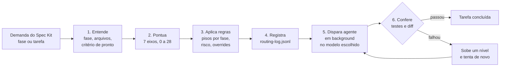

<p align="center">
  
</p>

# obama-skill

[](LICENSE)

Plugin do Claude Code com a skill **obama**: um roteador de modelos para o fluxo [Spec Kit](https://github.com/github/spec-kit).

> **Em uma frase:** o obama olha cada demanda do seu projeto, decide qual modelo de IA é o certo para ela e coloca um agente em background para executá-la. Cada tarefa roda no modelo mais barato que dá conta dela, e as decisões críticas sempre ficam com os modelos mais fortes.

## O problema

No fluxo do Spec Kit, uma feature vira dezenas de tarefas: algumas triviais (renomear um campo, gerar um DTO), outras críticas (desenhar o modelo de dados, escrever uma migração). Sem um critério, sobram duas opções, e as duas saem caras:

- **Rodar tudo no modelo mais forte:** funciona, mas você paga caro e espera mais em tarefas que um modelo leve resolveria em segundos.
- **Rodar tudo no modelo padrão:** fica mais barato, mas as tarefas difíceis saem erradas, voltam com bug e você paga o retrabalho, que custa mais do que o modelo forte teria custado.

Escolher na mão, tarefa por tarefa, até resolve. Só que tira você do fluxo e não fica registrado em lugar nenhum.

## O que o agente faz



1. **Entende a demanda.** Identifica a fase do Spec Kit, os arquivos e módulos afetados e o critério de pronto. Lê `spec.md`, `plan.md`, `tasks.md` e `data-model.md` da feature. Se não consegue definir o que é "pronto", trata a demanda como ambígua.
2. **Pontua em 7 eixos**, de 0 a 4 cada: complexidade de raciocínio, ambiguidade, abrangência, risco/reversibilidade, contexto necessário, novidade e histórico de falhas.
3. **Escolhe o modelo** pela nota e aplica as regras de segurança:

   | Nota | Modelo | Perfil da demanda |
   |---|---|---|
   | 0–6 | `haiku` | Mecânica e repetitiva: boilerplate, renomear, formatar, docstrings, CRUD copiando um padrão que já existe |
   | 7–14 | `sonnet` | O padrão de implementação: feature com spec clara, testes, endpoint novo dentro da arquitetura |
   | 15–21 | `opus` | Raciocínio pesado: arquitetura, modelo de dados, plano técnico, debugging difícil, mudanças em vários módulos |
   | 22–28 | `fable` | Fronteira: problemas longos e abertos, ou casos em que o `opus` já falhou |

   - **Pisos por fase:** `constitution`, `plan` e `analyze` nunca rodam abaixo do `opus`.
   - **Risco máximo** (migração de dados, auth, pagamentos, API externa) vai no mínimo para o `opus`.
   - **Segurança** (auditoria, pentest, RLS) vai para o `opus`, nunca para o `fable`, que tem salvaguardas extras nessa área.
   - **Overrides explícitos** vencem a classificação: tag `[model:opus]` na tarefa, pedido seu na conversa ou o `obama.config.json`.
4. **Registra a decisão** em `.specify/obama/routing-log.jsonl`, com a nota de cada eixo e o motivo da escolha em uma frase.
5. **Dispara o agente em background** com um prompt completo: artefatos a ler, tarefa, critério de pronto, regras da constitution e o que deve devolver. Tarefas marcadas com `[P]` rodam em paralelo.
6. **Confere o resultado** rodando os testes e lendo o diff. Se falhou, sobe um nível de modelo e tenta de novo, no máximo duas vezes. Depois disso, para e devolve para você com o diagnóstico.

### Exemplo de decisão

```json
{
  "fase": "implement",
  "tarefa": "T014",
  "resumo": "Endpoint POST /pedidos com validação e testes",
  "scores": {"raciocinio": 2, "ambiguidade": 1, "abrangencia": 2, "risco": 2, "contexto": 2, "novidade": 1, "historico": 0},
  "total": 10,
  "modelo": "sonnet",
  "motivo": "Feature com spec clara seguindo padrão de outros endpoints"
}
```

## Benefícios

- **Menos custo sem perder qualidade.** As tarefas mecânicas, que costumam ser a maioria de um `tasks.md`, vão para o `haiku`. O modelo forte fica para onde ele faz diferença.
- **Mais velocidade.** Modelos leves respondem mais rápido, e as tarefas `[P]` rodam em paralelo em background enquanto você segue trabalhando.
- **Menos retrabalho nas partes críticas.** Arquitetura, plano, migrações e segurança nunca caem num modelo fraco demais, mesmo que a nota saia baixa.
- **Falhas se corrigem sozinhas.** Quando uma tarefa falha, ela é escalada automaticamente com o erro anterior no prompt. Você só entra em cena se nem o escalonamento resolver.
- **Decisões auditáveis.** Cada escolha fica no log com nota e motivo, então dá para explicar por que uma tarefa rodou em determinado modelo e revisar o critério depois.
- **Melhora com o uso.** A cada ~30 decisões, o obama lê o log e sugere ajustes de limiar com base no que realmente escalou ou passou de primeira. Os ajustes são só propostos, e você decide se aplica.
- **Você continua no controle.** Uma tag na tarefa ou uma linha de config muda qualquer decisão, sem precisar mexer na skill.

## Quando não usar

- Projetos que não usam Spec Kit. A skill depende de `spec.md`, `plan.md` e `tasks.md` para entender cada demanda.
- Tarefas pequenas que você mesmo vai resolver na conversa. Nesse caso, o custo de montar um agente não compensa.

## Instalação

Dentro do Claude Code, no projeto:

```
/plugin marketplace add lucasalvesc/obama-skill
/plugin install obama@obama-skill
```

### Instalação automática por projeto

Para que todo mundo que clonar o projeto receba a skill, commite isto em `.claude/settings.json`:

```json
{
  "extraKnownMarketplaces": {
    "obama-skill": {
      "source": { "source": "github", "repo": "lucasalvesc/obama-skill" }
    }
  },
  "enabledPlugins": {
    "obama@obama-skill": true
  }
}
```

### Atualizar

```
/plugin marketplace update obama-skill
```

## Uso

- Automático: antes de delegar uma fase do speckit ou uma tarefa do `/speckit.implement`.
- Manual: `/obama <descrição da demanda>`.

### Overrides

- Na tarefa em `tasks.md`: `[model:opus]`
- Por projeto: `.specify/obama.config.json` (veja o exemplo na [SKILL.md](plugins/obama/skills/obama/SKILL.md))

## Estrutura

```
.claude-plugin/marketplace.json
plugins/obama/.claude-plugin/plugin.json
plugins/obama/skills/obama/SKILL.md
```

## Contribuindo

Issues e pull requests são bem-vindos. Para propor mudanças nas regras de roteamento (limiares, pisos por fase, eixos de pontuação), abra uma issue com exemplos de demandas e o modelo que você esperava.

## Licença

[MIT](LICENSE) © 2026 Lucas Alves Castro
